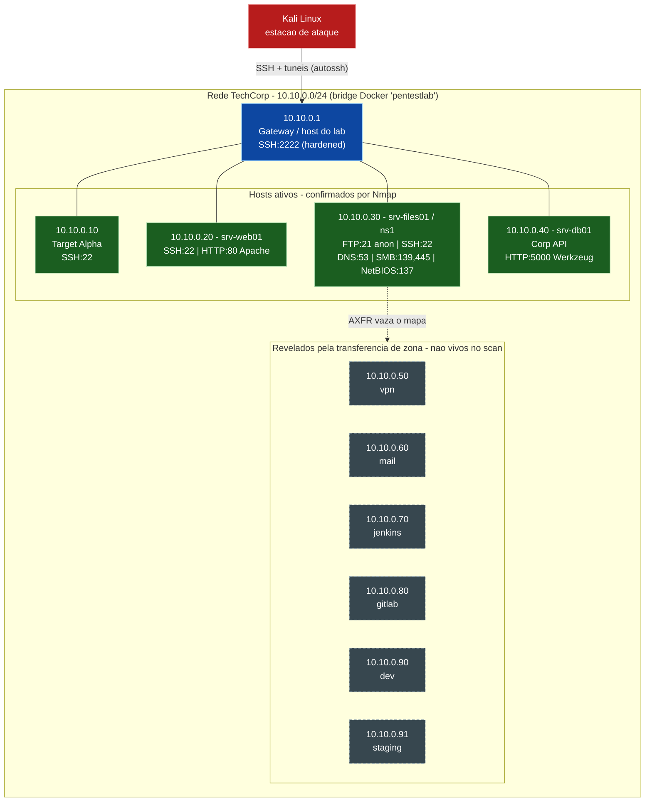

# Topologia da Rede — TechCorp (`10.10.0.0/24`)

Diagrama consolidado do reconhecimento: hosts ativos confirmados por Nmap +
hosts revelados pela transferência de zona DNS + serviços por host.

> Fontes: [varreduras-nmap.md](varreduras-nmap.md) e
> [transferencia-zona-dns.md](transferencia-zona-dns.md).

---

## Diagrama

**Legenda:** 🟥 estação de ataque · 🟦 infraestrutura/gateway · 🟩 host ativo
(confirmado por Nmap) · ⬛ (tracejado) host só conhecido via DNS, não respondeu
ao scan.

---

## Inventário de Hosts

| IP | Nome(s) DNS | Serviços | Estado | Papel |
|----|-------------|----------|--------|-------|
| 10.10.0.1 | — | SSH:2222 | Ativo | Gateway / host Docker do lab |
| 10.10.0.10 | — | SSH:22 | Ativo | Target Alpha (privesc) |
| 10.10.0.20 | srv-web01 | SSH:22, HTTP:80 | Ativo | Servidor web (Apache) |
| 10.10.0.30 | srv-files01, ns1, intranet, backup, admin | FTP:21, SSH:22, DNS:53, SMB:139/445, NetBIOS:137 | Ativo | Servidor de arquivos + DNS |
| 10.10.0.40 | srv-db01 | HTTP:5000 | Ativo | Corp API (Werkzeug/Flask) |
| 10.10.0.50 | vpn | — | Só DNS | Concentrador VPN |
| 10.10.0.60 | mail | — | Só DNS | Servidor de email |
| 10.10.0.70 | jenkins | — | Só DNS | CI/CD Jenkins |
| 10.10.0.80 | gitlab | — | Só DNS | Repositório GitLab |
| 10.10.0.90 | dev | — | Só DNS | Ambiente de desenvolvimento |
| 10.10.0.91 | staging | — | Só DNS | Ambiente de homologação |

---

## Redes Irmãs (fora do escopo do Projeto 01)

O host do lab também faz bridge para outras duas redes Docker, identificadas
durante o mapeamento mas fora do escopo deste projeto:

- `10.20.0.0/24` — rede `pentestlab-web`
- `10.10.1.0/24` — rede `windows-sim` (ambiente Windows / Active Directory)

---

> **Aviso:** Topologia de ambiente de laboratório controlado e de propriedade do
> testador. Todos os IPs, hostnames e dados são fictícios.
